# CRUD com ORM: ORMLite + SQLite, entidade `Produto`

Atividade de **Mapeamento Objeto-Relacional (ORM)**: implementação das operações
CRUD (Create, Read, Update e Delete) de uma classe de modelo do meu projeto,
usando **Java + ORMLite + SQLite** e o **padrão Repository** do
[tutorial de ORM](https://github.com/marceloakira/tutorials/tree/main/orm).

**Autora:** Anna Carolina Limonta, Engenharia de Computação (UFG)

---

## 1. Classe escolhida: `Produto`

A entidade vem do meu projeto
[**sistema-vendas-eventos**](https://github.com/annalimonta/sistema-vendas-eventos),
um PDV para eventos universitários (vendas, estoque e caixa). O `Produto` é o item
vendido no caixa do evento (pastel, cachorro-quente, refrigerante...) e é a base
das outras partes do sistema: venda, item de venda e movimento de estoque se
referem a ele.

A classe foi mapeada para a tabela `produtos`, com os mesmos nomes de coluna do
schema SQL do projeto (`sql/01_schema.sql`). Também segui a convenção do projeto
de guardar **dinheiro em centavos (`int`)**, porque ponto flutuante acumula erro
de arredondamento.

### Mapeamento objeto → tabela

| Atributo Java          | Coluna           | Tipo gerado no SQLite               | Configuração no ORMLite                                    |
|------------------------|------------------|-------------------------------------|------------------------------------------------------------|
| `int id`               | `id`             | `INTEGER PRIMARY KEY AUTOINCREMENT` | `@DatabaseField(generatedId = true)`                       |
| `String nome`          | `nome`           | `VARCHAR NOT NULL`                  | `@DatabaseField(canBeNull = false)`                        |
| `String categoria`     | `categoria`      | `VARCHAR`                           | `@DatabaseField`                                           |
| `int precoCentavos`    | `preco_centavos` | `INTEGER NOT NULL`                  | `@DatabaseField(columnName = "preco_centavos", canBeNull = false)` |
| `boolean ativo`        | `ativo`          | `BOOLEAN NOT NULL` (gravado 0/1)    | `@DatabaseField(canBeNull = false)`                        |
| `Date criadoEm`        | `criado_em`      | `VARCHAR` (`yyyy-MM-dd HH:mm:ss`)   | `@DatabaseField(columnName = "criado_em", dataType = DataType.DATE_STRING, format = ...)` |

```java
@DatabaseTable(tableName = "produtos")
public class Produto
{
    @DatabaseField(generatedId = true)
    private int id;

    @DatabaseField(canBeNull = false)
    private String nome;

    @DatabaseField
    private String categoria;

    @DatabaseField(columnName = "preco_centavos", canBeNull = false)
    private int precoCentavos;

    @DatabaseField(canBeNull = false)
    private boolean ativo;

    @DatabaseField(columnName = "criado_em", dataType = DataType.DATE_STRING,
                   format = "yyyy-MM-dd HH:mm:ss")
    private Date criadoEm;

    public Produto() { ... }   // construtor vazio, obrigatório para o ORMLite
    ...
}
```

A tabela não é criada à mão: o `TableUtils.createTableIfNotExists` do ORMLite
gera o `CREATE TABLE` a partir dessas anotações (ver o print "Estado final do
banco", na seção 3.2).

> **Simplificações em relação ao schema original:** no projeto o `id` é UUID e a
> categoria é uma chave estrangeira para a tabela `categorias`. Aqui, como a
> atividade pede uma entidade, usei `id` inteiro autoincrementado (como no
> tutorial) e a categoria como texto. A coluna `evento_id` ficou de fora.

---

## 2. Implementação

| Arquivo                      | Papel |
|------------------------------|-------|
| `Database.java`              | Conexão com o arquivo SQLite (`JdbcConnectionSource`). Igual à do tutorial. |
| `Produto.java`               | Entidade com as anotações `@DatabaseTable` / `@DatabaseField`. |
| `ProdutoRepository.java`     | **Padrão Repository**: as quatro operações CRUD, usando o `Dao<Produto, Integer>` do ORMLite. |
| `ProdutoRepositoryTest.java` | Testes JUnit 5 das quatro operações e da persistência. |
| `DemonstracaoCrud.java`      | Demonstração passo a passo (uma operação por execução). |
| `ConsultaSQL.java`           | Lê a tabela com **SQL puro via JDBC, sem o ORM**, para conferir o que está gravado no arquivo do banco. |
| `+libs/`                     | Bibliotecas do tutorial: `sqlite-jdbc-3.46.0.0`, `ormlite-core-6.1`, `ormlite-jdbc-6.1`, `slf4j-api-2.0.13`, `slf4j-simple-2.0.13`. |
| `simplelogger.properties`    | Manda o log do ORMLite para o `System.out`. Por padrão ele vai para o `System.err`, que o BlueJ pinta de vermelho como se fosse erro. |

### O repositório

O `ProdutoRepository` segue a estrutura do `StudentRepository` do tutorial:
`database` e `dao` estáticos, um cache dos objetos carregados (`loadedProdutos`
e `loadedProduto`) e os mesmos nomes de método. Os métodos `update` e `delete`,
que no tutorial ficaram como `// TODO`, foram implementados.

| Operação   | Método do repositório        | Método do `Dao` (ORMLite)         | SQL equivalente gerado pelo ORM          |
|------------|------------------------------|-----------------------------------|------------------------------------------|
| **Create** | `create(Produto)`            | `dao.create(produto)`             | `INSERT INTO produtos (...) VALUES (...)`|
| **Read**   | `loadFromId(int)`            | `dao.queryForId(id)`              | `SELECT * FROM produtos WHERE id = ?`    |
| **Read**   | `loadAll()`                  | `dao.queryForAll()`               | `SELECT * FROM produtos`                 |
| **Update** | `update(Produto)`            | `dao.update(produto)`             | `UPDATE produtos SET ... WHERE id = ?`   |
| **Delete** | `delete(Produto)`            | `dao.delete(produto)`             | `DELETE FROM produtos WHERE id = ?`      |

```java
public void update(Produto produto) {
    int nrows = 0;
    try {
        nrows = dao.update(produto);
        if ( nrows == 0 )
            throw new SQLException("Error: object not updated (id " + produto.getId() + " not found)");
        removeFromLoaded(produto.getId());
        this.loadedProduto = produto;
        loadedProdutos.add(produto);
    } catch (SQLException e) {
        System.out.println(e);
    }
}

public void delete(Produto produto) {
    int nrows = 0;
    try {
        nrows = dao.delete(produto);
        if ( nrows == 0 )
            throw new SQLException("Error: object not deleted (id " + produto.getId() + " not found)");
        removeFromLoaded(produto.getId());
        if (this.loadedProduto != null && this.loadedProduto.getId() == produto.getId())
            this.loadedProduto = null;
    } catch (SQLException e) {
        System.out.println(e);
    }
}
```

Em nenhum momento o código da aplicação escreve SQL: quem traduz as chamadas
`create`, `queryForId`, `update` e `delete` para comandos SQL é o ORMLite. A única
classe com SQL é a `ConsultaSQL`, e ela existe só para **conferir** o banco por
fora do ORM.

---

## 3. Evidências de funcionamento

As operações foram demonstradas de duas formas: **no BlueJ**, com testes
interativos como no tutorial (3.1), e **pelo terminal**, com cada operação numa
execução separada do programa (3.2).

### 3.1 No BlueJ

#### Projeto compilado

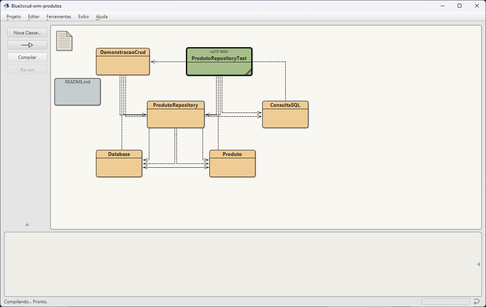

Projeto aberto e compilado no BlueJ 6.0.1. As bibliotecas da pasta `+libs` foram
carregadas automaticamente, sem configuração extra. O BlueJ mostra as
dependências entre as classes: `ProdutoRepository` usa `Database` e `Produto`, e
a classe de teste usa o repositório.

#### Testes JUnit no BlueJ

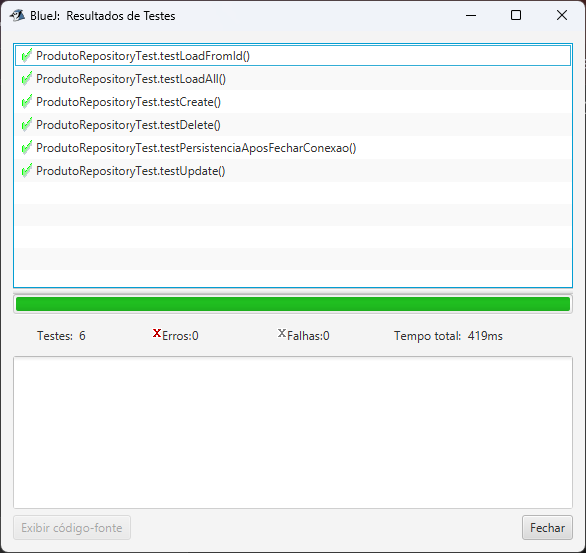

Botão direito em `ProdutoRepositoryTest` → **Testar Tudo**. Os 6 testes passaram
com **0 erros e 0 falhas**. A seção "Testes automatizados" (3.2) explica o que
cada teste comprova.

#### CREATE: `DemonstracaoCrud.criar()`

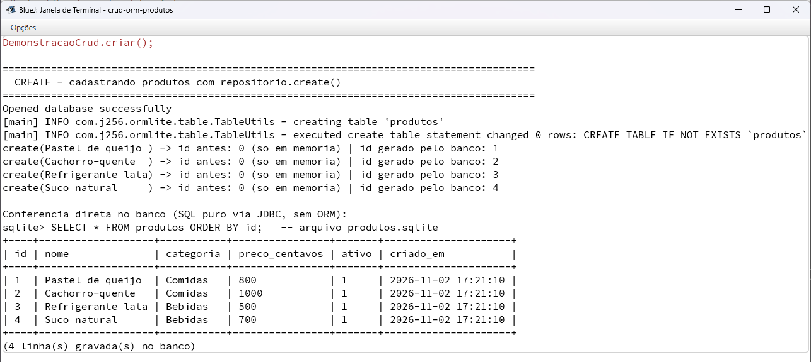

Botão direito em `DemonstracaoCrud` → `void criar()`. A Janela de Terminal do
BlueJ mostra, em vermelho, a chamada feita (opção *Anotar chamadas de métodos*).
Logo abaixo aparecem o `CREATE TABLE` gerado pelo ORMLite, os ids 1 a 4 gerados
pelo banco e a conferência com SQL puro: **4 linhas gravadas** em `produtos.sqlite`.

#### READ: `DemonstracaoCrud.consultar()`

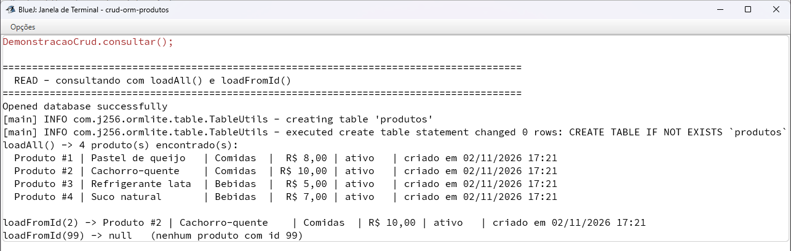

`loadAll()` traz os 4 produtos, `loadFromId(2)` devolve o *Cachorro-quente* e
`loadFromId(99)` devolve `null`.

#### UPDATE: `DemonstracaoCrud.atualizar(3)`

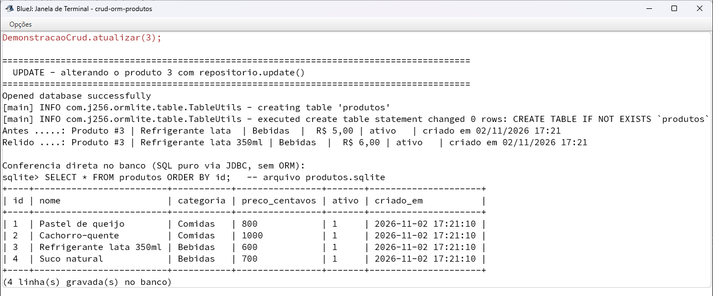

O produto 3 passa de *Refrigerante lata* / R$ 5,00 para *Refrigerante lata 350ml* /
R$ 6,00. A linha `id = 3` da tabela mostra `preco_centavos = 600`, e a tabela
continua com 4 linhas.

#### DELETE: `DemonstracaoCrud.excluir(4)`

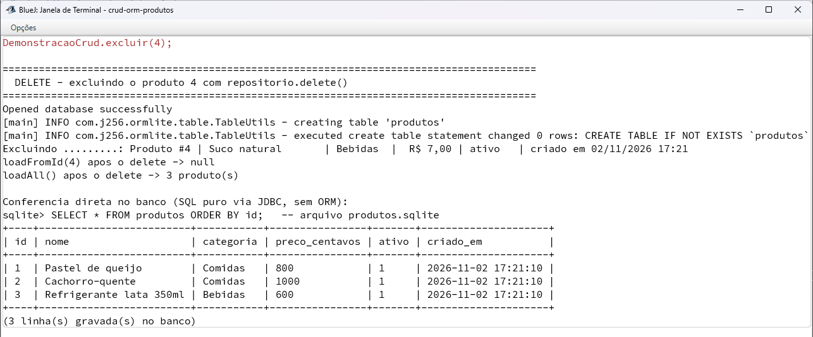

Depois do `delete()`, `loadFromId(4)` devolve `null` e a tabela fica com
**3 linhas**: a linha `id = 4` não existe mais no arquivo do banco.

#### Teste interativo com a bancada de objetos (como no tutorial)

Pelos menus do BlueJ foram criados os objetos `database1`
(`new Database("produtos.sqlite")`), `produtoR1` (`new ProdutoRepository(database1)`)
e `produto1` (`new Produto("Pastel de carne", "Comidas", 900)`).

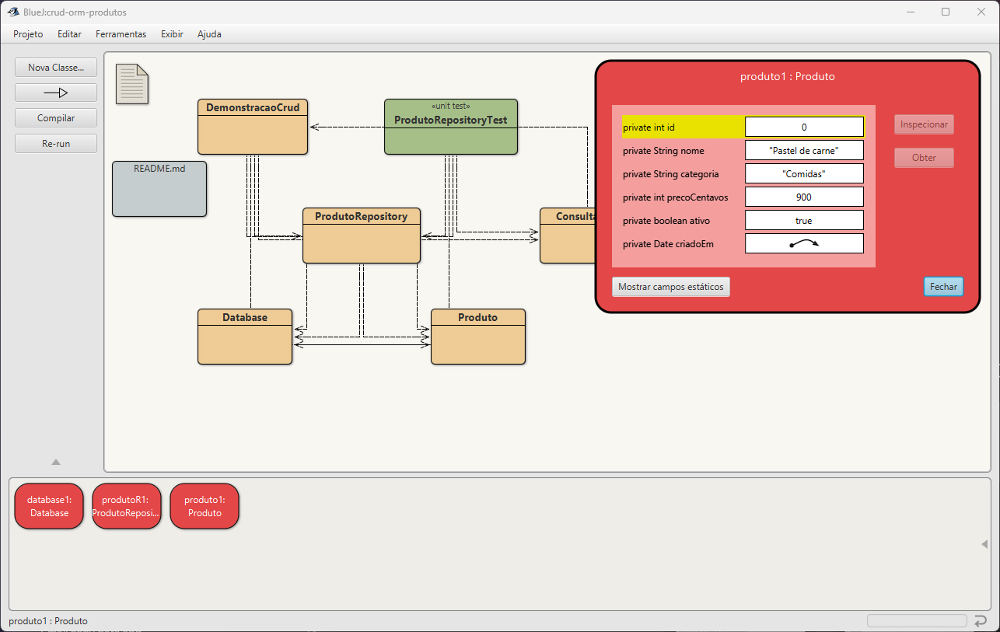

**Antes do `create`:** o inspetor de `produto1` mostra `id = 0`. O objeto é
**transiente**, existe só na memória.

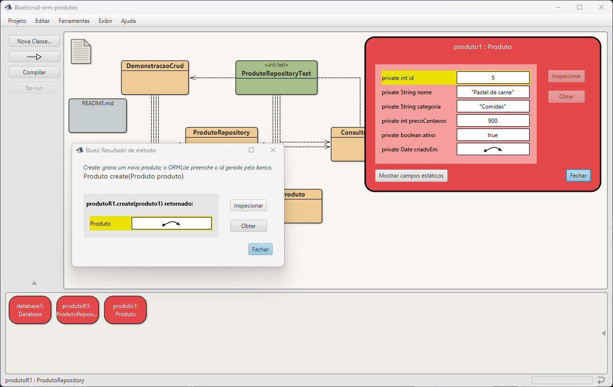

**`produtoR1.create(produto1)`:** o mesmo objeto agora tem `id = 5`, gerado pelo
banco. Os ids 1 a 3 já existiam, e o 4 foi excluído no passo anterior. O
`AUTOINCREMENT` do SQLite não reaproveita ids.

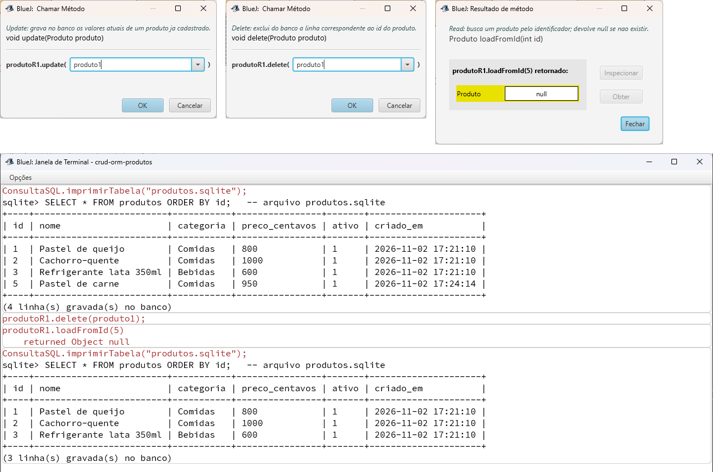

**Update e delete pela bancada:**
- O preço foi alterado com `produto1.setPrecoCentavos(950)` e gravado com
  `produtoR1.update(produto1)` (1º diálogo). A conferência com SQL puro
  (`ConsultaSQL.imprimirTabela`) mostra a linha `id = 5` com
  `preco_centavos = 950`.
- Em seguida, `produtoR1.delete(produto1)` (2º diálogo) e `produtoR1.loadFromId(5)`,
  que devolve `null` (3º diálogo). A nova conferência mostra que a linha
  `id = 5` foi apagada do banco.

### 3.2 Pelo terminal

Cada operação foi executada **em uma execução separada do programa**, começando de
um banco vazio. Assim, quando a consulta (passo 2) encontra os produtos, isso
comprova que eles foram lidos do **arquivo `produtos.sqlite`**, e não da memória
do programa que os criou.

Ao final de cada operação, a classe `ConsultaSQL` faz um `SELECT * FROM produtos`
direto pelo driver JDBC, sem ORMLite e sem a classe `Produto`, e mostra o que de
fato está gravado na tabela.

#### Print 1: CREATE, cadastro de produtos

```
java -cp ".;+libs/*" DemonstracaoCrud criar
```

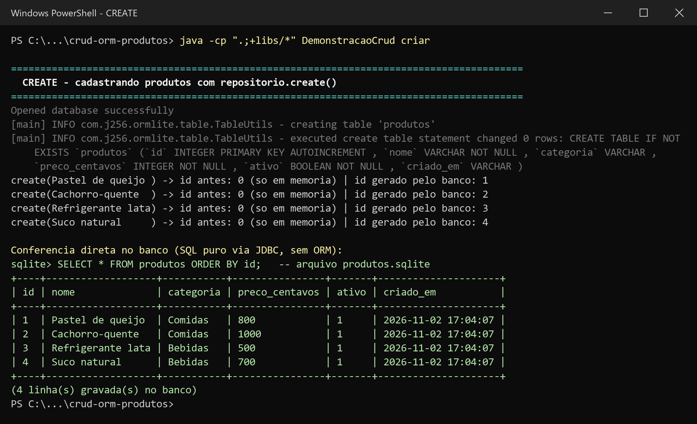

- Na primeira execução o ORMLite cria a tabela `produtos`. O log mostra o
  `CREATE TABLE` que ele gerou a partir das anotações da classe.
- Antes do `create()`, cada objeto `Produto` tem `id = 0`, porque é um objeto
  **transiente** que só existe na memória. Depois do `create()`, o banco
  gerou os ids 1, 2, 3 e 4, e o ORMLite os preencheu no próprio objeto.
- A conferência com SQL puro mostra as **4 linhas gravadas** no arquivo, com
  os nomes de coluna do mapeamento (`preco_centavos`, `criado_em`).

#### Print 2: READ, consulta por listagem e por identificador

```
java -cp ".;+libs/*" DemonstracaoCrud consultar
```

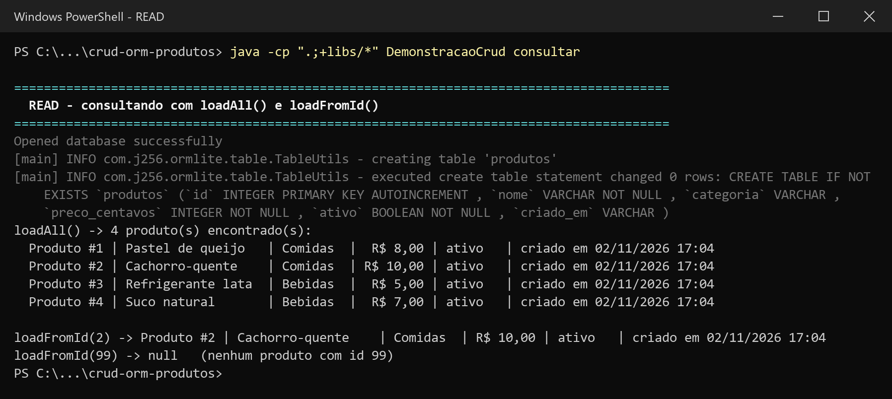

- Esta é uma **nova execução do programa**: nada foi cadastrado nela, e mesmo
  assim `loadAll()` encontrou os 4 produtos. Os dados persistiram no banco.
- `loadAll()` lista todos os produtos (`dao.queryForAll()`).
- `loadFromId(2)` busca um produto pelo identificador (`dao.queryForId(2)`) e
  devolve o *Cachorro-quente*.
- `loadFromId(99)` devolve `null`, porque não existe produto com esse id.

#### Print 3: UPDATE, alteração de um produto existente

```
java -cp ".;+libs/*" DemonstracaoCrud atualizar 3
```

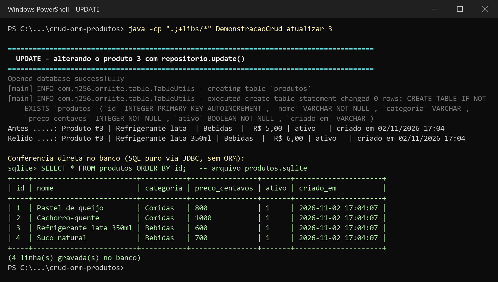

- O produto 3 (*Refrigerante lata*, R$ 5,00) foi carregado, teve o nome e o
  preço alterados em memória e foi salvo com `update()`.
- A linha **Relido** vem de um novo `loadFromId(3)`, que vai ao banco e monta
  um objeto novo, já com *Refrigerante lata 350ml* e R$ 6,00.
- Na tabela (SQL puro), a linha `id = 3` mostra `nome = Refrigerante lata 350ml`
  e `preco_centavos = 600`. Continua havendo 4 linhas, porque o update alterou a
  linha existente e não criou outra.

#### Print 4: DELETE, exclusão de um produto

```
java -cp ".;+libs/*" DemonstracaoCrud excluir 4
```

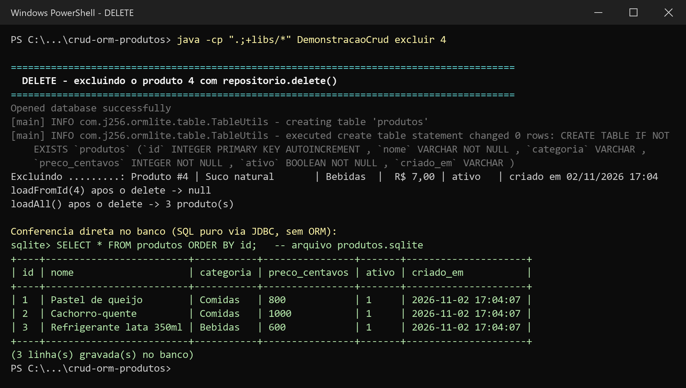

- O produto 4 (*Suco natural*) foi excluído com `delete()`.
- Logo depois, `loadFromId(4)` devolve `null` e `loadAll()` encontra só 3
  produtos.
- Na tabela (SQL puro), a linha `id = 4` **não existe mais**: restam 3 linhas
  no arquivo do banco.

#### Print 5: Estado final do banco, conferido fora do ORM

```
java -cp ".;+libs/*" ConsultaSQL produtos.sqlite
```

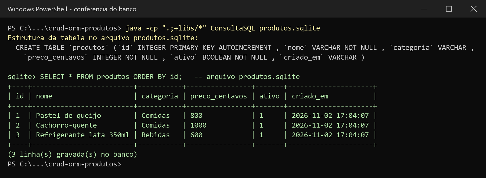

Execução independente, que só lê o arquivo `produtos.sqlite` com SQL:

- **Estrutura:** o `CREATE TABLE produtos` gravado no `sqlite_master` foi o
  gerado pelo ORMLite a partir das anotações da classe `Produto`.
- **Dados:** o resultado final das quatro operações. Os produtos 1 e 2 estão
  como foram cadastrados, o 3 tem os valores atualizados e o 4 foi excluído.

#### Print 6: Testes automatizados (JUnit 5)

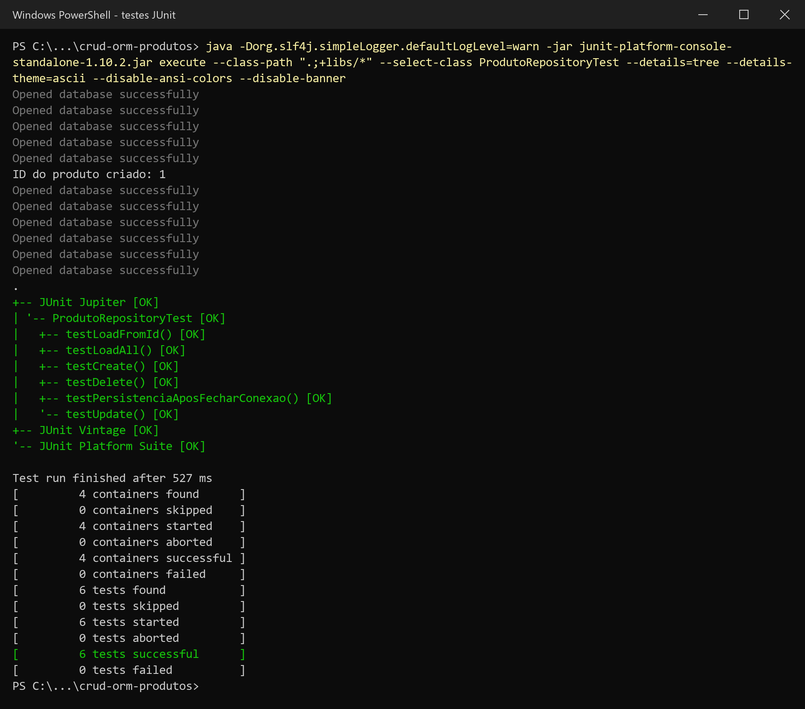

Os 6 testes da classe `ProdutoRepositoryTest` passaram. Cada um começa com um
banco vazio próprio (`teste-produtos.sqlite`) e, para provar que a operação
chegou ao arquivo, **fecha e reabre a conexão** antes de conferir. Alguns também
contam as linhas com SQL puro (`ConsultaSQL.contarProdutos`).

| Teste                               | O que comprova |
|-------------------------------------|----------------|
| `testCreate`                        | O objeto transiente tem id 0; depois do `create` recebe um id gerado pelo banco e a tabela passa a ter 1 linha. |
| `testLoadFromId`                    | Depois de reabrir o banco, `loadFromId` devolve o produto com todos os campos certos; id inexistente devolve `null`. |
| `testLoadAll`                       | `loadAll` devolve os 3 produtos cadastrados, na ordem. |
| `testUpdate`                        | Nome, preço e situação alterados aparecem depois de reabrir o banco, sem criar linha nova. |
| `testDelete`                        | O produto excluído some do banco, o outro continua lá e a tabela fica com 1 linha. |
| `testPersistenciaAposFecharConexao` | Um produto gravado continua no arquivo depois que a conexão é fechada e aberta de novo. |

---

## 4. Como executar

### No BlueJ

1. Abra a pasta do projeto em **Projeto → Abrir Projeto**. As bibliotecas da
   pasta `+libs` são carregadas automaticamente pelo BlueJ. Se preferir, elas
   também podem ser adicionadas em *Preferências → Bibliotecas*, como no tutorial.
2. Clique em **Compilar**.
3. **Testes interativos**, como no tutorial:
   - botão direito em `Database` → `new Database("produtos.sqlite")`;
   - botão direito em `ProdutoRepository` → `new ProdutoRepository(database1)`;
   - botão direito em `Produto` → `new Produto("Pastel de carne", "Comidas", 900)`;
     com dois cliques no objeto `produto1` o inspetor mostra `id = 0`;
   - no objeto `produtoR1`: `create(produto1)` (o `id` passa a ser o gerado pelo
     banco), `loadAll()`, `loadFromId(...)`;
   - `produto1.setPrecoCentavos(950)` e depois `produtoR1.update(produto1)`;
   - `produtoR1.delete(produto1)` e depois `loadFromId(...)`, que devolve `null`;
   - para ver o que está gravado no banco: botão direito em `ConsultaSQL` →
     `imprimirTabela("produtos.sqlite")`.
4. **Demonstração:** botão direito em `DemonstracaoCrud` e chame `criar()`,
   `consultar()`, `atualizar(3)` e `excluir(4)`. Na Janela de Terminal, a opção
   *Opções → Anotar chamadas de métodos* mostra cada chamada feita.
5. **Testes automatizados:** botão direito em `ProdutoRepositoryTest` → **Testar Tudo**.

### Pelo terminal (Windows / PowerShell)

```powershell
# compilar o código da aplicação
javac -encoding UTF-8 -cp "+libs/*" Database.java Produto.java ProdutoRepository.java ConsultaSQL.java DemonstracaoCrud.java

# demonstração, uma operação por execução
java -cp ".;+libs/*" DemonstracaoCrud criar
java -cp ".;+libs/*" DemonstracaoCrud consultar
java -cp ".;+libs/*" DemonstracaoCrud atualizar 3
java -cp ".;+libs/*" DemonstracaoCrud excluir 4

# conferir o banco com SQL puro
java -cp ".;+libs/*" ConsultaSQL produtos.sqlite
```

Para rodar os testes fora do BlueJ, use o
[junit-platform-console-standalone-1.10.2.jar](https://repo1.maven.org/maven2/org/junit/platform/junit-platform-console-standalone/1.10.2/junit-platform-console-standalone-1.10.2.jar):

```powershell
javac -encoding UTF-8 -cp "+libs/*;junit-platform-console-standalone-1.10.2.jar" *.java
java -jar junit-platform-console-standalone-1.10.2.jar execute --class-path ".;+libs/sqlite-jdbc-3.46.0.0.jar;+libs/ormlite-core-6.1.jar;+libs/ormlite-jdbc-6.1.jar;+libs/slf4j-api-2.0.13.jar;+libs/slf4j-simple-2.0.13.jar" --select-class ProdutoRepositoryTest
```

No Linux/macOS, troque o separador `;` por `:` no classpath.

**Ambiente usado:** OpenJDK 21, sqlite-jdbc 3.46.0.0, ORMLite 6.1, SLF4J 2.0.13 e JUnit 5.10.
